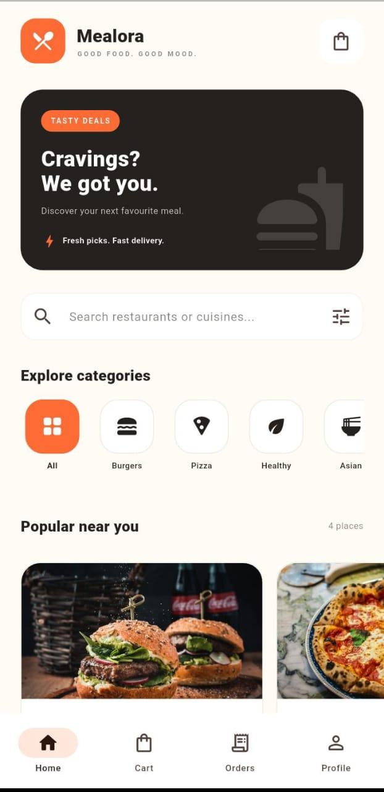

# Mealora — Food Delivery App

<p align="center">
  A modern food delivery application built with Flutter.
</p>

<p align="center">
  
</p>

<p align="center">
  
  
  
  
  
</p>

## Overview

Mealora is a Flutter food delivery application developed as part of the Auspify Task 06 project. It provides a user-friendly interface for exploring food options, managing a cart, placing demo orders, and viewing order history.

## Features

- Browse restaurants and food categories.
- Search for restaurants and explore available options.
- Add items to the cart.
- Increase or decrease item quantities and remove items.
- Review the cart and complete checkout.
- Place demo orders and view order history.
- View simulated order tracking.
- Save and update profile information.
- Persist supported app data locally using SharedPreferences.
- Responsive Flutter interface for supported screen sizes.

## Tech Stack

- **Flutter** — cross-platform UI framework
- **Dart** — programming language
- **Provider** — state management
- **SharedPreferences** — local data persistence
- **Flutter SVG** — SVG asset rendering

## Getting Started

### Prerequisites

Install the [Flutter SDK](https://docs.flutter.dev/get-started/install) and configure an Android device, emulator, or supported development environment.

### Installation

Clone the repository:

```bash
git clone https://github.com/SilvaDeShakila/mealora-food-delivery-app.git
cd mealora-food-delivery-app
flutter pub get
flutter run
```

## Testing

Run the automated tests:

```bash
flutter test
```

Check the project with the Dart analyzer:

```bash
flutter analyze
```

The automated widget test checks that the application launches and key home-screen content is displayed. Main user flows have also been manually checked on a physical phone.

## Demo Behaviour and Limitations

This is a demonstration application. Restaurant and food data are static demo data. Checkout and payment are simulated; the app does not process real payments. Order tracking is simulated and does not provide live delivery-driver GPS tracking.

## Future Improvements

- Connect a live restaurant and food API.
- Add secure user authentication.
- Integrate a real payment gateway.
- Implement backend order management and live delivery tracking.
- Expand automated tests for cart, checkout, and profile workflows.

## Repository

[Mealora — Food Delivery App](https://github.com/SilvaDeShakila/mealora-food-delivery-app)

---

Developed with Flutter and Dart.
